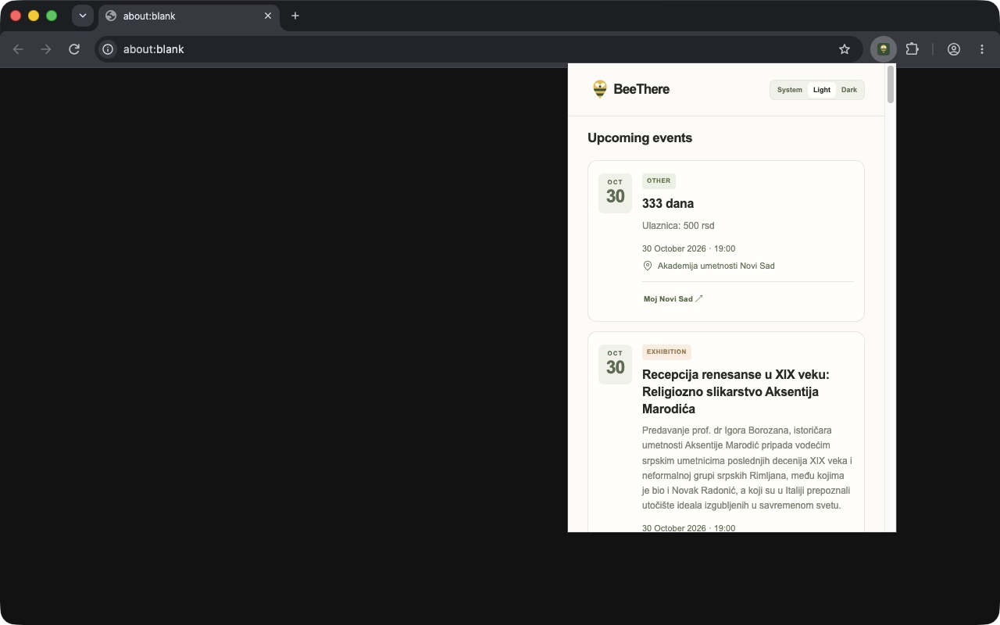

# BeeThere

**Discover events in Novi Sad, right from your browser.**

BeeThere brings local event listings into a Chrome extension. Open the toolbar
popup, find something that interests you, and follow the link to the original
listing for more details.

## What you can do

- **Browse local events** without leaving your current tab.
- **See the essentials at a glance:** title, summary, category, date, time,
  and venue when available.
- **Read times in Novi Sad local time**, regardless of your device's timezone.
- **Open the original listing** to check details with the publisher.
- **Choose light, dark, or system theme.** Your preference is saved.

## Try it locally

BeeThere is in early development. The current setup uses a local backend and
an unpacked Chrome extension. Event coverage currently comes from
[Moj Novi Sad](https://www.mojnovisad.com/); it is not a complete city calendar.

1. **Start the backend.** Follow the [backend setup and ingestion guide](backend/README.md#test-the-end-to-end-flow)
   to apply migrations, import event listings, and run the API.
2. **Build the extension.** Follow the [extension guide](extension/README.md)
   with `http://127.0.0.1:8000` as the API origin.
3. **Load it in Chrome.** Follow [Install in Chrome](extension/README.md#install-in-chrome),
   then open BeeThere from the toolbar.

Listings can be incomplete or change. Check the original source before making
plans. Search, category/date filters, and saved events are not available yet.

## Project docs

| Guide | What you will find |
| --- | --- |
| [Browser extension](extension/README.md) | Requirements, build, tests, Chrome installation, and release packaging |
| [Backend](backend/README.md) | API setup, event ingestion, database migrations, and containers |
| [Architecture](docs/architecture.md) | System design, module boundaries, and event data flow |
| [Development and releases](docs/development.md) | Quality checks, CI, image publishing, and Git hooks |
| [Security scanning](docs/security-scanning.md) | Scan coverage, local commands, and security review rules |

## License

[MIT](LICENSE) · Copyright (c) 2026 Petar Ćevriz.
